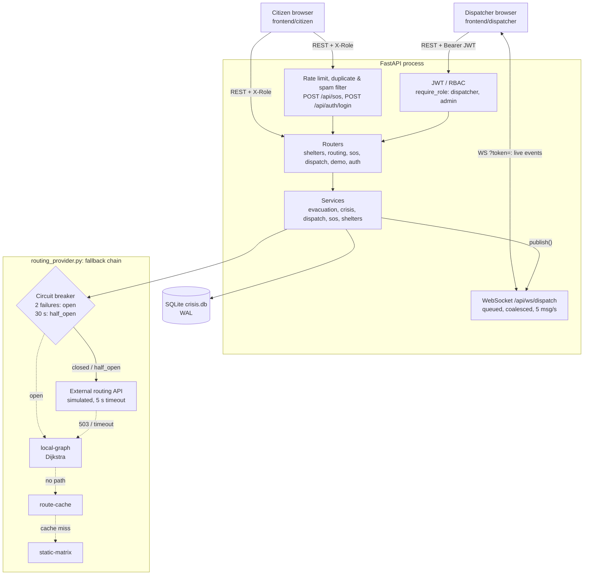
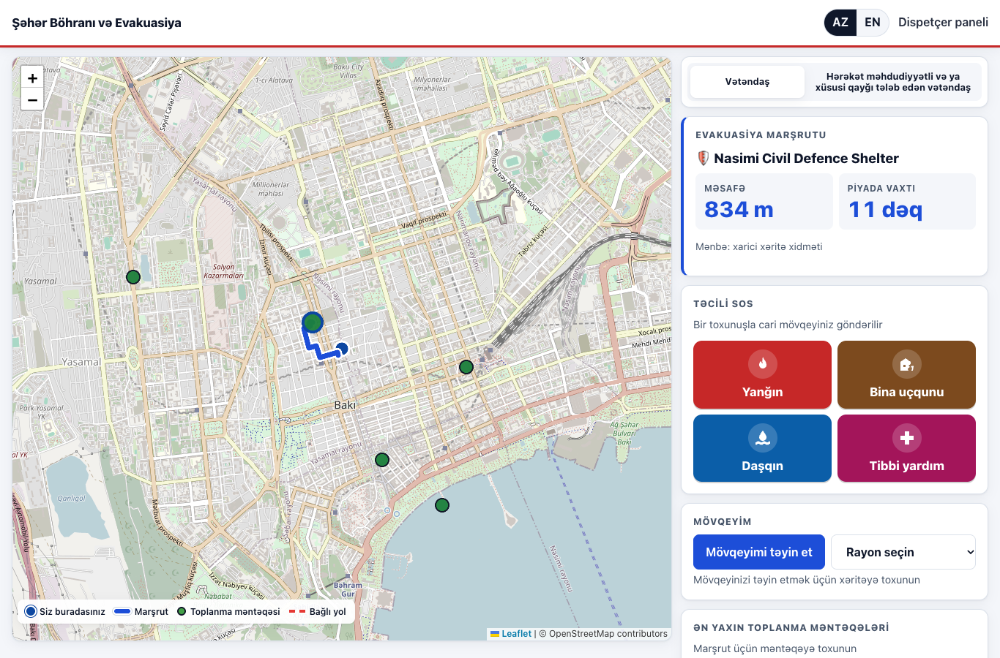
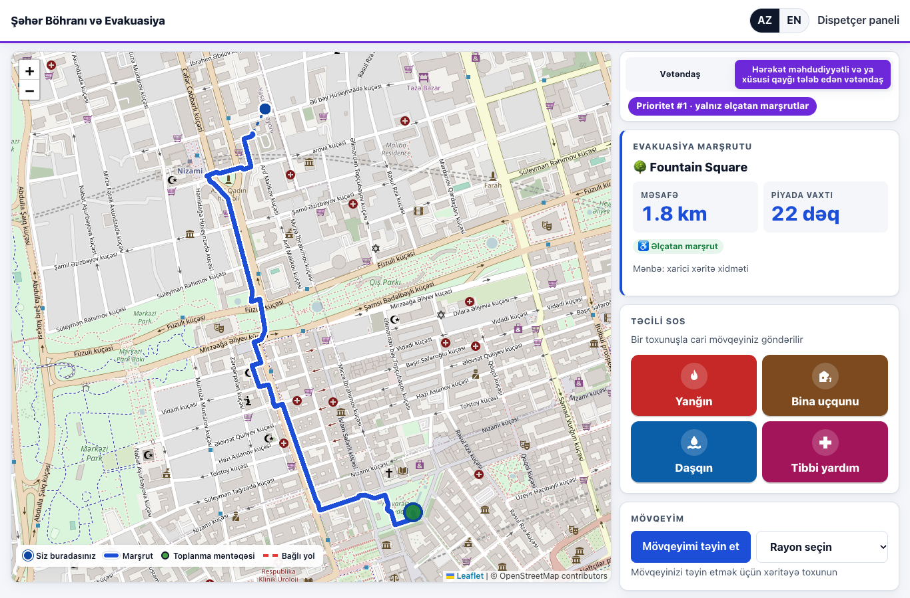
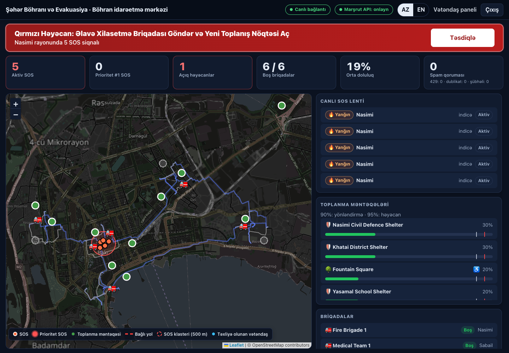
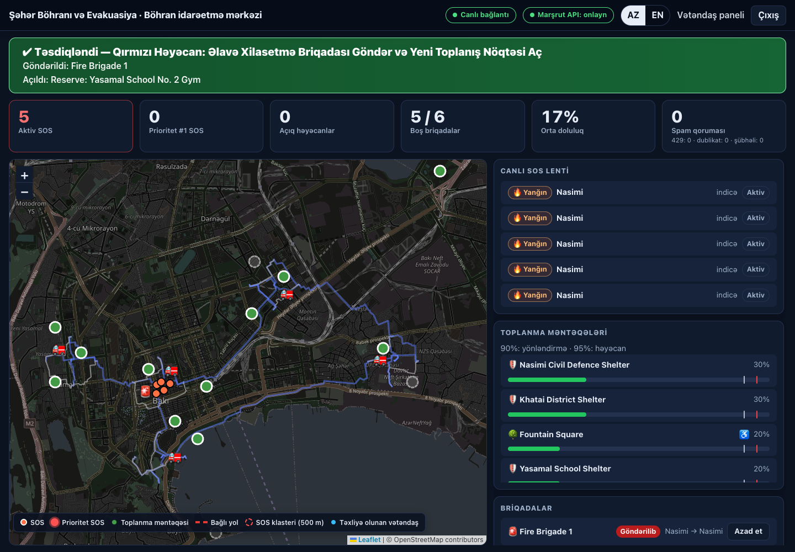
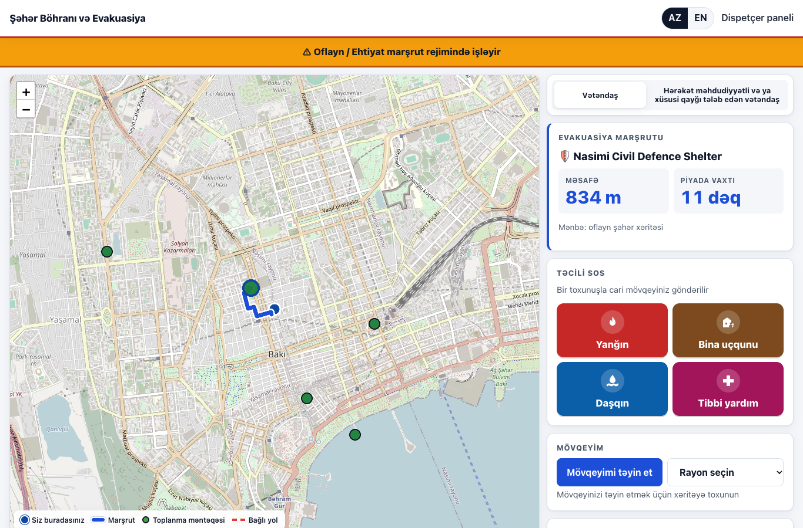
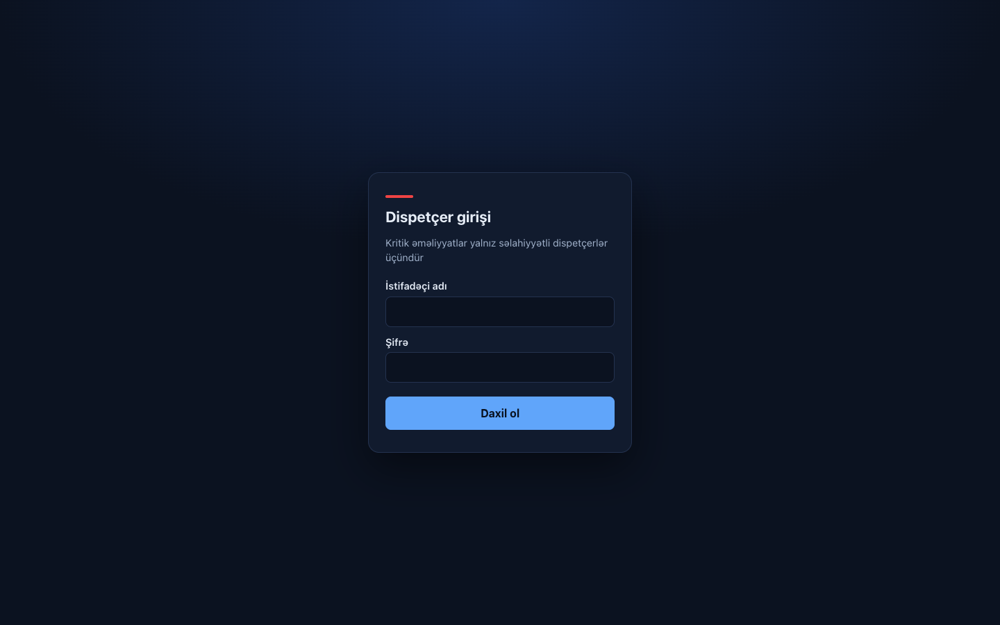
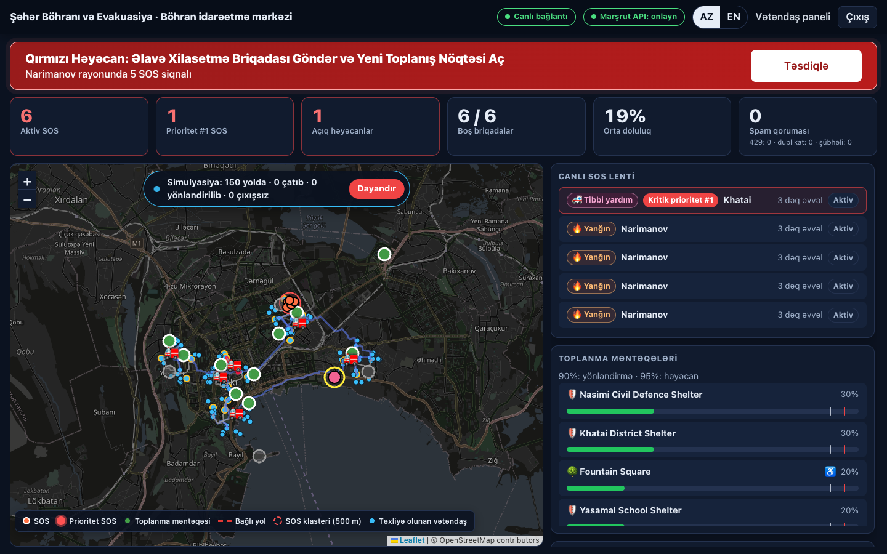

# Urban Crisis & Crowd Evacuation Engine

A hackathon prototype for city-scale emergencies in Baku. Citizens get a live evacuation route along real streets to
the nearest assembly point that is not full and not cut off by a closed road, and can send a one-tap SOS. Dispatchers
see every SOS on a live map. A **Red Alert** fires when SOS signals cluster or a shelter overflows, and one click
dispatches the nearest free brigade and opens a reserve assembly point.

- **Citizen app** (`/`): bilingual AZ/EN, priority (mobility-impaired) mode, nearest shelters with occupancy, a route
  that refreshes every 5 s with automatic reroute banners, four SOS buttons, an "I am safe" button, and an offline /
  backup routing notice.
- **Dispatcher dashboard** (`/dispatcher/`): JWT login, Red Alert banner with one-click confirm, KPIs including flood
  protection, a live map, SOS feed, shelters, brigades, zones, alert history, and a demo simulator with a live
  evacuation simulation of virtual citizens.
- **Backend**: FastAPI + SQLAlchemy 2 + SQLite (WAL), a WebSocket for live events, 24 REST endpoints plus 1 WebSocket.

What is real and what is simulated: street geometry and walking distances come from OpenStreetMap. They were
precomputed once with `backend/scripts/snap_roads.py` and are never fetched at runtime. Shelter locations are real
landmarks with approximate coordinates. The external routing API, the occupancy values, the accessibility flags and
the brigade positions (each brigade sits at its zone centre) are simulated.

**Team:** Ülvi Mustafayev (backend & API), Anar Hümmətli (frontend & UI/UX), Xizri Saxrayev (AI integration, testing & documentation).

## Run on macOS (venv + uvicorn)

```bash
python3.12 -m venv .venv
source .venv/bin/activate
pip install -r requirements.txt
uvicorn backend.app.main:app --reload        # http://localhost:8000
```

- Citizen app: http://localhost:8000/
- Dispatcher dashboard: http://localhost:8000/dispatcher/
- API docs (OpenAPI): http://localhost:8000/docs

`crisis.db` is created and seeded on first start: 5 zones, 10 open shelters, 4 closed reserves, 6 brigades, and a
25-node / 44-road graph. Delete `crisis.db*` to reseed.

Optional environment variables: `DATABASE_URL`, `JWT_SECRET`, `DISPATCHER_PASSWORD`, `ADMIN_PASSWORD`.

## Run with Docker (not verified)

The `Dockerfile` has not been built or run yet: the Docker daemon was not available when it was written.

```bash
docker build -t crisis-engine .
docker run --rm -p 8000:8000 -e JWT_SECRET=change-me -v crisis-data:/data crisis-engine
```

The SQLite file lives in the `/data` volume. Behind Docker's port mapping, every browser may reach the app from the
same gateway IP. The per-IP limits (20 SOS/min, and more than 5 citizen ids per IP marks SOS as suspected spam) then
apply to all users together.

## Demo logins (dispatcher dashboard)

Staff accounts are seeded from `backend/app/config.py` (`STAFF_USERS`). Change the passwords via environment
variables before any real use.

| Username | Password (default) | Role | Env override |
|---|---|---|---|
| `dispatcher` | `dispatcher123` | dispatcher | `DISPATCHER_PASSWORD` |
| `admin` | `admin123` | admin | `ADMIN_PASSWORD` |

- Tokens are HS256 JWTs, valid for 8 h and signed with `JWT_SECRET`. If `JWT_SECRET` is unset, a random secret is
  generated on every start, so a restart logs everyone out.
- Every staff API call needs `Authorization: Bearer <token>`, and the WebSocket needs `?token=`.
- Both roles can use every staff endpoint; there is no admin-only endpoint yet.
- Citizens do not log in. Their role (`citizen` or `priority_citizen`) comes from the `X-Role` header, which the
  profile toggle in the citizen app sets.

```bash
TOKEN=$(curl -s -X POST localhost:8000/api/auth/login -H 'Content-Type: application/json' \
  -d '{"username":"dispatcher","password":"dispatcher123"}' | python -c 'import sys,json;print(json.load(sys.stdin)["access_token"])')
curl -s localhost:8000/api/dispatch/overview -H "Authorization: Bearer $TOKEN" | head -c 200
```

## Tests

```bash
source .venv/bin/activate
pytest -q
```

The suite has 11 test files and 117 tests; all 117 pass (`pytest -q`, about 1.4 s). It runs against a throwaway SQLite file in a temp directory and never
touches `crisis.db`. Time-based rules (the 5-minute Red Alert window, the circuit-breaker cooldown, the rate limits)
are tested with injectable or fake clocks rather than real waiting; the slow-API test uses a small timeout.

### Flood test (Challenge Drop 3)

The flood test is not part of pytest. Run it against a server started without `--reload` on a fresh database:

```bash
rm -f crisis.db crisis.db-shm crisis.db-wal
uvicorn backend.app.main:app --port 8000 --log-level warning &
python tests/load/flood_test.py --base http://127.0.0.1:8000 --n 600
```

It sends 600 fake SOS from 6 client processes on one IP. Meanwhile, a logged-in dispatcher polls the overview,
triggers one legitimate burst and confirms its Red Alert. The last recorded run had a mean of 116 ms, p95 211 ms, and
545 × 429. All 15 accepted fakes were marked as suspected spam and raised no alert. The legitimate burst raised one
alert, which was confirmed. Full output is in [docs/load-test-results.md](docs/load-test-results.md).

## Demo walkthrough

1. Open the **citizen app** and click the map in central Baku (or pick a district). The nearest open shelter is shown
   with occupancy, and the route follows the streets: a thick line, plus a dashed line for the first straight leg.
2. Switch the profile to **priority citizen**. The badge appears, and the route now uses only accessible roads and
   shelters. Basement shelters are skipped.
3. Open the **dispatcher dashboard** in another window and log in as `dispatcher`.
4. In the simulator, set the selected shelter's occupancy to 90% or more. Within 5 s the citizen app shows a reroute
   banner (`shelter_full`). Push it above 95% and the dispatcher gets a `shelter_overflow` Red Alert.
5. Switch the simulator to road mode and click a road on the citizen's route to close it. The citizen is rerouted
   around it (`road_closed`).
6. Click a point on the map and press **SOS burst** (4 citizens within 240 m). A Red Alert appears:
   *"Qırmızı Həyəcan: Əlavə Xilasetmə Briqadası Göndər və Yeni Toplanış Nöqtəsi Aç"*. Click **Confirm**: the nearest
   free brigade is dispatched and the nearest closed reserve shelter opens, and both show on the map.
7. Press **503** (or **Slow**) under external routing. After 2 failures the circuit breaker opens, routes come from
   the local backup, and the citizen app shows *"Oflayn / Ehtiyat marşrut rejimində işləyir"*. After 30 s one trial
   call is made, and **Up** brings it back online.
8. Start the **evacuation simulation** (`POST /api/demo/simulate`, by default 150 virtual citizens at 20× walking
   speed, 10% of them priority citizens). The citizens walk their recommended street routes. Arrivals fill the
   shelters, which triggers the 90% reroute and the 95% Red Alert by themselves.
9. **Reset** restores the seed state and stops the simulation.

## Architecture



A rendered version with Azerbaijani labels is in [docs/architecture.png](docs/architecture.png).

## Challenge Drop adaptations

### Drop 1: priority citizens and accessible routes

- **Required:** a mobility-impaired / special-care citizen role. Their SOS gets Critical Priority #1, and they are
  only given wheelchair / medical-transport accessible routes. The UI must switch between AZ and EN.
- **What we changed:**
  - Added a `priority_citizen` role. The SOS priority comes from the role and never from the request body, and a
    repeat SOS never downgrades it.
  - Added `is_accessible` on roads and shelters. 32 of the 44 roads and 7 of the 10 open shelters are accessible.
  - Added an `accessible_only` flag through every routing provider. Priority citizens never get a straight-line
    route; when nothing accessible is reachable, the API returns `reason: no_accessible_route` with
    `needs_medical_transport: true`.
- **Why it was cheap:**
  - Roles already had one extension point in `routers/auth.py` (`ROLES` and `require_role`).
  - Routing already sat behind the provider interface.
  - The API already returned codes only, and all UI text lived in `frontend/shared/i18n.js`, so adding a language is
    a dictionary change.

### Drop 2: the external Map & Routing API goes down (HTTP 503 or slower than 5 s)

- **Required:** no crash; a circuit breaker / fallback engages automatically; routes come from the local backup data;
  users see "Oflayn / Ehtiyat marşrut rejimində işləyir".
- **What we changed:**
  - The simulated external API now runs with a hard 5 s timeout in a worker thread.
  - Added a thread-safe circuit breaker: 2 consecutive failures open it, after 30 s it goes `half_open`, and it makes
    one trial call.
  - Added the fallback chain `local-graph` → `route-cache` (new table) → `static-matrix` (new zone × shelter table
    built at startup). Priority citizens never get the matrix.
  - Added `degraded`, `mode` and `notice_code` to `/api/route`. `/api/health` always answers 200. Breaker state
    changes are broadcast over the WebSocket.
  - Leaflet is vendored, and the map falls back to vector roads when the OSM tiles do not load.
- **Why it was cheap:**
  - Since the first routing task, routing lived behind `services/routing_provider.py` with a local-graph fallback, so
    the breaker and two more providers slotted into the existing chain.
  - All thresholds were already in `config.py`, and live events already had one publish function.

### Drop 3: SOS flood, JWT/RBAC and latency

- **Required:** survive a flood of more than 500 fake SOS requests, secure dispatcher operations with JWT/RBAC, and
  keep the mean latency under 300 ms.
- **What we changed:**
  - Rate limits use an in-memory sliding window: 20 SOS/min per IP, 3/min per citizen and 5 logins/min per IP. Over
    the limit, the API answers 429 with `Retry-After`.
  - A raw ASGI gate (`services/flood_gate.py`) rejects IPs that are already over the limit before routing, and the
    SOS route is async.
  - A duplicate payload within 10 s, or a repeated `Idempotency-Key`, returns the existing SOS.
  - When one IP sends more than 5 citizen ids in 60 s, its SOS are stored as `suspected_spam`. These are excluded
    from Red Alerts, the feed, the KPIs and the map. Priority citizens are never marked as spam.
  - `POST /api/auth/login` issues an HS256 JWT (PBKDF2-SHA256 password hashes). Every staff endpoint and the WebSocket
    require it, and `X-Role` is now only for citizens.
  - The overview is cached for 1 s and capped at 100 SOS (totals stay exact). WebSocket events are queued and
    coalesced to at most 5 messages per second.
  - The measured mean latency under the flood is 116 ms.
- **Why it was cheap:**
  - Every staff endpoint already depended on the single `require_role(...)`, so switching from a header to JWT
    happened in one place.
  - All live events already went through `ws.publish()`, which became the queue.
  - The Red Alert rules were pure functions, so excluding spam was one filter.
  - Routers were thin, so the SOS route could become async with the DB work moved to one thread-pool call.

## Documentation

- Technical write-up (Azerbaijani): [docs/TEXNIKI_IZAH.docx](docs/TEXNIKI_IZAH.docx), with its source in
  [docs/TEXNIKI_IZAH.md](docs/TEXNIKI_IZAH.md)
- Load / flood test results: [docs/load-test-results.md](docs/load-test-results.md)
- AI usage log: [AI_DECLARATION.md](AI_DECLARATION.md)
- Screenshots: [docs/screenshots/](docs/screenshots/)

| | |
|---|---|
|  |  |
|  |  |
|  |  |
|  | |
