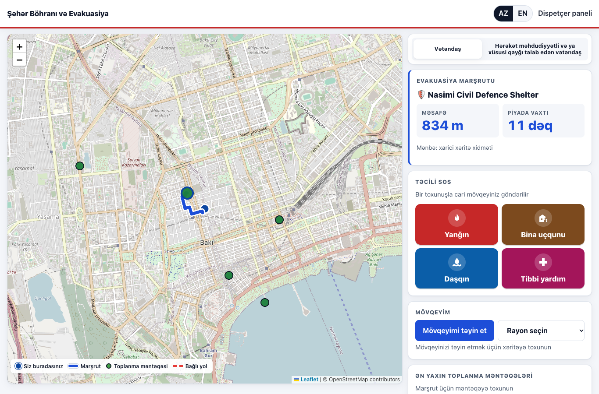
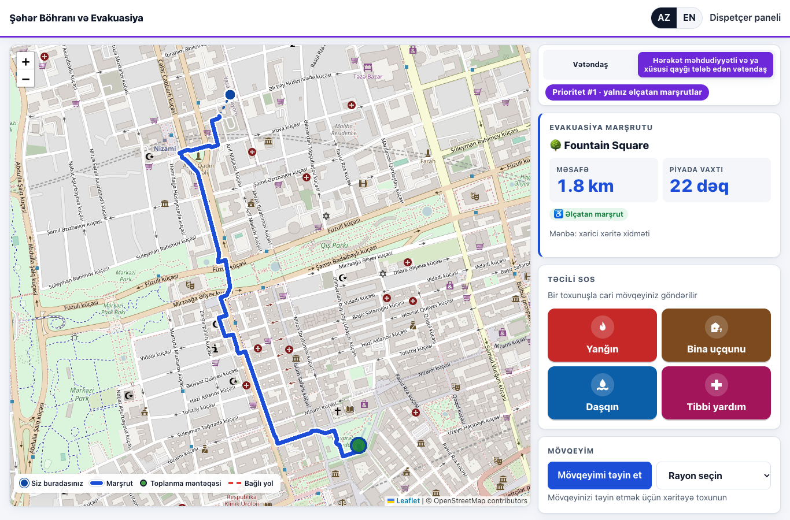
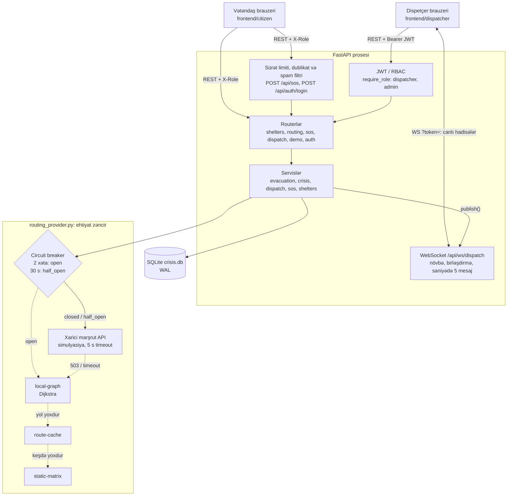
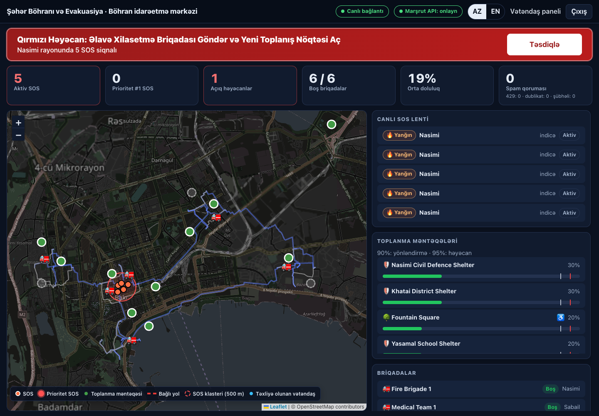
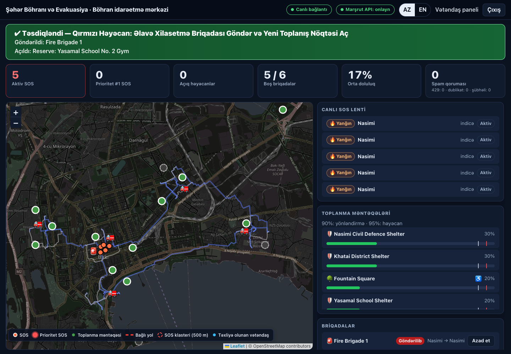
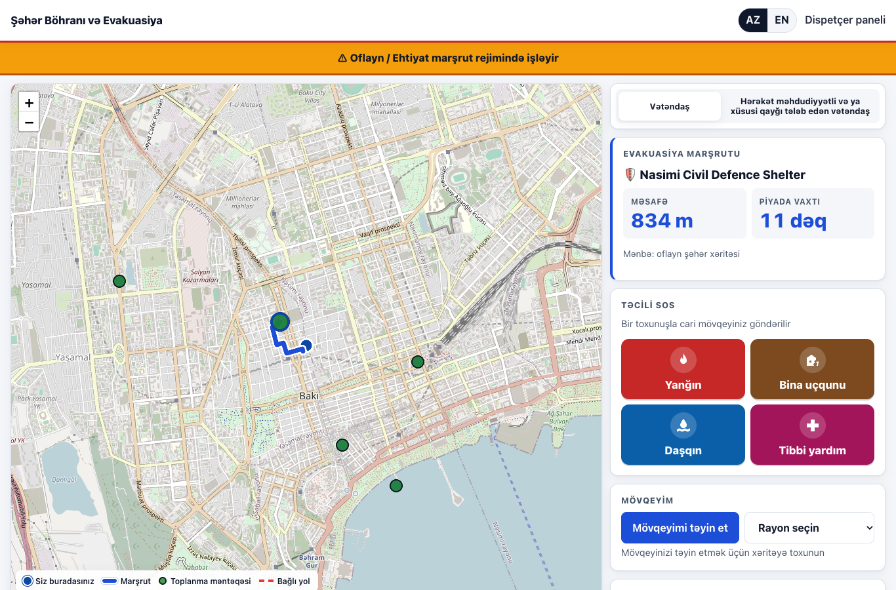
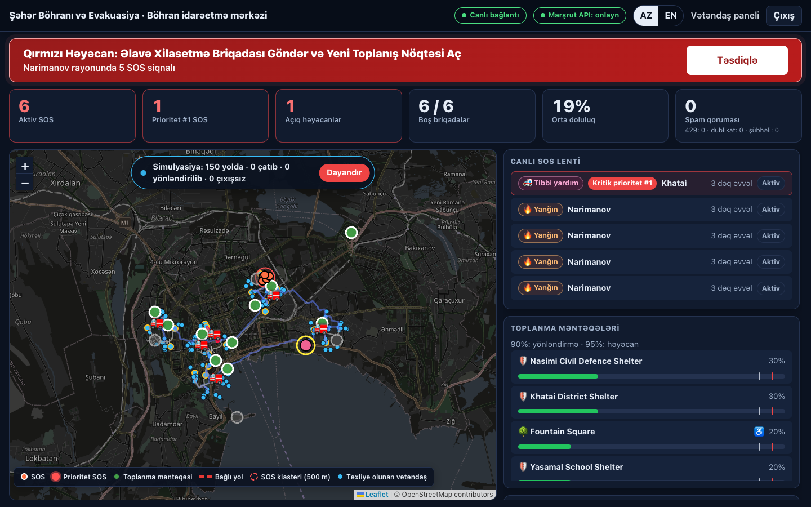

# Şəhər Böhranı və Kütləvi Təxliyyə Mühərriki — Texniki izah

**Komanda:** Ülvi Mustafayev (backend və API), Anar Hümmətli (frontend və UI/UX), Xizri Saxrayev (süni intellekt inteqrasiyası, testləşdirmə və sənədləşmə).

## 1. Problemin konteksti

Zəlzələ, yanğın, daşqın və ya binanın uçması kimi fövqəladə hallarda şəhər sakinlərinin böyük hissəsi eyni anda hərəkətə keçir. Bəzi küçələr dağıntı və ya yanğın səbəbindən bağlanır, ən yaxın sığınacaqların girişlərində isə izdiham və panika yaranır.

Bu vəziyyətdə iki tərəf eyni məlumat çatışmazlığından əziyyət çəkir:

- **Vətəndaş** hansı sığınacağın artıq dolu olduğunu və hansı küçənin bağlandığını görmür. O, çox vaxt ən yaxın, lakin artıq dolmuş məntəqəyə gedir və yolda bağlı küçəyə rast gəlir.
- **Dispetçer** eyni anda gələn onlarla SOS siqnalını əl ilə çeşidləyə bilmir. Hansı məhəllədə kütləvi hadisə baş verdiyini, hansı siqnalın hərəkət imkanı məhdud vətəndaşdan gəldiyini və hansı sığınacağın dolmaq üzrə olduğunu tez görmək çətindir.

Bundan əlavə, xarici xəritə və marşrut xidmətləri böhran anında yüklənə və ya tamamilə əlçatmaz ola bilər, SOS kanalı isə saxta və ya təkrar sorğularla doldurula bilər. Sistem bu şəraitdə də işləməlidir.

## 2. Təklif olunan həll

Sistem iki veb səhifədən və onlara xidmət edən vahid FastAPI serverindən ibarətdir. Bütün interfeys mətnləri Azərbaycan və ingilis dillərindədir (AZ | EN keçidi), API isə yalnız kodlar qaytarır.

**Vətəndaş paneli (`/`):**

- profil seçimi: adi vətəndaş və ya prioritet vətəndaş (hərəkət imkanı məhdud); prioritet rejimdə nişan göstərilir;
- Bakı xəritəsi; mövqe xəritəyə toxunmaqla, cihazın geolokasiyası ilə və ya rayon seçməklə təyin olunur;
- ən yaxın açıq toplanış məntəqələrinin siyahısı: növ, məsafə, doluluq zolağı, "dolu" və "əlçatan" nişanları; məntəqəyə toxunduqda marşrut ona qurulur;
- real küçələr boyunca çəkilmiş marşrut (qalın xətt), vətəndaşdan ilk küçə nöqtəsinə qədər qırıq xətt, məsafə, piyada ETA və marşrut mənbəyi;
- marşrut hər 5 saniyədən bir yenilənir; məntəqə dolduqda və ya yol bağlandıqda tərcümə olunmuş yönləndirmə banneri, əlçatan marşrut tapılmadıqda qırmızı xəbərdarlıq göstərilir;
- dörd SOS düyməsi (yanğın, uçqun, daşqın, tibbi), aktiv SOS kartı (prioritet etiketi ilə) və "Təhlükəsizəm" düyməsi; aktiv SOS səhifə yenilənəndə də saxlanılır;
- xarici marşrut xidməti işləmədikdə sarı "Oflayn / Ehtiyat marşrut rejimində işləyir" bildirişi.

**Dispetçer paneli (`/dispatcher/`):**

- istifadəçi adı və parolla giriş (JWT); token brauzerin `sessionStorage`-ində saxlanılır;
- yanıb-sönən Qırmızı Həyəcan banneri: "Qırmızı Həyəcan: Əlavə Xilasetmə Briqadası Göndər və Yeni Toplanış Nöqtəsi Aç", səbəb, prioritet SOS nişanı və bir "Təsdiqlə" düyməsi;
- göstəricilər sırası: aktiv SOS, prioritet SOS, açıq həyəcanlar, boş briqadalar, orta doluluq və "Spam qoruması" (429, dublikat və şübhəli sorğuların sayı);
- xəritə: təhlükə növünə görə SOS nöqtələri (prioritet SOS daha böyük və halqalı), doluluğa görə rənglənən məntəqələr, bağlı və əlçatmaz yollar, briqadalar, 500 m-lik klaster dairələri;
- panellər: SOS axını, 90% və 95% işarələri olan məntəqələr, "Azad et" düyməli briqadalar, zonalar cədvəli, həyəcan tarixçəsi;
- marşrut xidmətinin vəziyyəti (circuit breaker) və geri sayım göstəricisi;
- demo simulyatoru: virtual vətəndaşlarla canlı təxliyyə simulyasiyası, xəritədə seçilmiş nöqtədə SOS dalğası, prioritet SOS, məntəqə doluluğu sürgüsü, xəritədə yolu bağlama/açma, xarici API-ni "işləyir / 503 / yavaş" rejiminə keçirmə, sıfırlama.

**Nə realdır, nə simulyasiyadır:**

| Element | Vəziyyət |
|---|---|
| Küçə həndəsəsi və piyada yol uzunluqları | Real: OpenStreetMap məlumatı, `routing.openstreetmap.de` piyada profili ilə bir dəfə hesablanıb və `backend/app/data/road_geometry.json` faylında saxlanılıb; işləmə zamanı xidmətə müraciət edilmir |
| Yol qrafının qovşaqları | 25 süni nöqtə (hər zonada mərkəz + 4 istiqamət), ən yaxın real küçəyə "yapışdırılıb" |
| Sığınacaq koordinatları | Real obyektlər (Dənizkənarı bulvar, Fəvvarələr meydanı, Olimpiya stadionu və s.), koordinatlar təxminidir |
| Tutum və doluluq | Seed məlumatı; doluluğu dispetçer əl ilə dəyişir |
| Əlçatanlıq (pilləkən, dik yol) | Süni işarələnmə, real ölçmə deyil |
| Briqadaların mövqeyi | Öz zonasının mərkəzi hesab olunur |
| Xarici marşrut API | Simulyasiya: real HTTP sorğusu yoxdur, rejim (`up`, `down_503`, `slow`) proqramdan dəyişdirilir |
| SOS dalğaları | Demo üçün simulyatorla yaradılır; adi SOS real vətəndaş axını ilə eyni yoldan keçir |





## 3. Arxitektura və məlumat axını

Sistem bir FastAPI prosesində işləyir. Server həm REST API-ni (`/api`, 24 endpoint), həm WebSocket kanalını (`/api/ws/dispatch`), həm də statik frontend fayllarını təqdim edir. Bütün vəziyyət SQLite faylında (`crisis.db`, WAL rejimi) saxlanılır; sürət limitləri, spam filtri, circuit breaker və overview keşi isə proses yaddaşındadır.



**SOS siqnalının yolu:**

1. Vətəndaş təhlükə düyməsinə (məs., "Yanğın") toxunur. Brauzer `POST /api/sos` sorğusunu `{lat, lon, hazard_type, citizen_id}` ilə və `X-Role` başlığı (`citizen` və ya `priority_citizen`) ilə göndərir.
2. Əvvəlcə xam ASGI qatı (`services/flood_gate.py`) işləyir: IP artıq limiti (dəqiqədə 20 SOS) aşıbsa, sorğu FastAPI marşrutlaşdırmasından, JSON oxunmasından və axın hovuzundan əvvəl 429 alır. Sonra asinxron router verilənlər bazasına yazmazdan əvvəl yaddaşda qoruma yoxlamalarını edir: eyni `Idempotency-Key` və ya 10 saniyə ərzində eyni IP-dən eyni məzmun gələrsə, mövcud SOS 200 kodu ilə qaytarılır; IP üzrə (dəqiqədə 20) və ya vətəndaş üzrə (dəqiqədə 3) limit aşılarsa, 429 və `Retry-After` qaytarılır; bir IP-dən 60 saniyədə 5-dən çox fərqli `citizen_id` gələrsə, SOS `suspected_spam` kimi qeyd olunur.
3. Yalnız qəbul edilmiş SOS axın hovuzuna (`run_in_threadpool`) və bazaya çatır. `services/sos.py` ən yaxın zonanı təyin edir, prioriteti yalnız roldan götürür (prioritet vətəndaş = 1, kritik) və vətəndaşın yeganə aktiv SOS-unu yaradır və ya yeniləyir (qismən unikal indeks). Təkrar SOS prioriteti heç vaxt aşağı salmır.
4. `services/crisis.py` (`on_sos_created`) son 5 dəqiqənin aktiv, spam olmayan SOS-larını SQL ilə seçir (eyni zona və ya 500 m-lik çərçivə), sonra təmiz funksiya `find_sos_cluster` ilə qaydanı yoxlayır. Qayda ödənirsə, zonanın açıq həyəcanı yaradılır və ya böyüdülür.
5. Router commit-dən sonra `sos_created` və `alert_created` / `alert_updated` hadisələrini `ws.publish()` ilə növbəyə qoyur. Fon tapşırığı növbəni saniyədə ən çox 5 dəfə boşaldır; bir neçə hadisə yığılıbsa, onlar bir `batch` mesajında göndərilir.
6. Dispetçer səhifəsi hadisəni alır və `GET /api/dispatch/overview` sorğusunu (500 ms tənzimləmə ilə) yenidən edir. Qırmızı Həyəcan banneri görünür.
7. Dispetçer "Təsdiqlə" düyməsini basır: `POST /api/dispatch/alerts/{id}/confirm`. Bir tranzaksiyada həyəcan "təsdiqlənmiş" statusuna keçir, ən yaxın boş briqada göndərilir və ən yaxın bağlı ehtiyat məntəqə açılır (yoxdursa, zona mərkəzində müvəqqəti toplanış nöqtəsi yaradılır). İkinci təsdiq 409 qaytarır. `alert_confirmed`, `brigade_updated` və `shelter_updated` hadisələri yayımlanır.
8. Vətəndaş səhifəsi növbəti 5 saniyəlik yeniləmədə yeni açılmış məntəqəni siyahıda görür və marşrut lazım gəldikdə ona yönləndirilir.

**Fon tapşırıqları.** Serverdə yalnız bir daimi fon tapşırığı var: `ws.drain_forever()`, WebSocket növbəsini hər 0,2 saniyədən bir boşaldır (`WS_MAX_MESSAGES_PER_S = 5`). Server işə düşərkən (`lifespan`) cədvəllər yaradılır, baza boşdursa seed yüklənir, zonalar yaddaşa alınır, statik məsafə matrisi hesablanır və işçi hesabları yaradılır. Xarici API-yə hər çağırış ayrıca daemon axında 5 saniyəlik sərt timeout ilə işləyir. Brauzer tərəfində vətəndaş səhifəsi hər 5 saniyədən bir yenilənir; dispetçer səhifəsi WebSocket kəsildikdə 10 saniyəyə qədər artan fasilələrlə yenidən qoşulur və bu müddətdə hər 3 saniyədən bir sorğu (polling) edir. Təxliyyə simulyasiyası işə salındıqda (`POST /api/demo/simulate`) ayrıca asyncio tapşırığı hər saniyədə bir addım icra edir (`SIM_TICK_S = 1`); simulyasiya bitdikdə, dayandırıldıqda və ya yenidən başladıldıqda bu tapşırıq dayanır.

Diaqramın PNG variantı: [architecture.png](architecture.png).

## 4. Texnologiyalar və seçim səbəbləri

| Texnologiya | Niyə seçilib |
|---|---|
| Python 3.12, FastAPI | Pydantic ilə avtomatik giriş yoxlaması, avtomatik API sənədləri (`/docs`), eyni prosesdə REST və WebSocket |
| SQLAlchemy 2 + SQLite | Ayrıca server tələb etmir, tək fayldır; WAL və `busy_timeout=5000` oxucuların yazıçı ilə paralel işləməsinə imkan verir; qismən unikal indekslər "bir vətəndaş — bir aktiv SOS" və "bir zona — bir açıq həyəcan" qaydalarını baza səviyyəsində qoruyur |
| WebSocket | Dispetçerə hadisələri dərhal çatdırmaq üçün; kəsildikdə səhifə sorğu rejiminə keçir |
| Vanilla HTML/CSS/JavaScript | Yığma (build) mərhələsi yoxdur, kodu münsiflər birbaşa oxuya bilər |
| Leaflet 1.9.4 (layihəyə daxil edilib) | Açıq xəritə kitabxanası; CDN-dən asılı deyil, internet olmadan da yüklənir |
| OpenStreetMap + OSRM piyada profili | Real küçə həndəsəsi və piyada məsafələri; yalnız bir dəfəlik skriptlə istifadə olunur, nəticə repozitoriyada saxlanılır |
| PyJWT (HS256) + PBKDF2-SHA256 (`hashlib`) | İşçi girişləri üçün standart, əlavə xidmət tələb etməyən autentifikasiya |
| pytest + httpx TestClient | API-ni server işə salmadan, müvəqqəti bazada yoxlamaq; saxta saatla zamana bağlı qaydaları gözləmədən test etmək |
| httpx + asyncio + multiprocessing | Sel testi skripti (`tests/load/flood_test.py`): 6 müştəri prosesi eyni anda 600 SOS göndərir. Locust da `requirements.txt`-dədir, lakin repozitoriyada Locust ssenarisi yoxdur |
| Docker | Layihəni istənilən kompüterdə bir əmrlə işə salmaq üçün (`Dockerfile`) |

## 5. Layihənin strukturu

```
./  (layihənin kök qovluğu)
├── backend/
│   ├── app/
│   │   ├── main.py              FastAPI tətbiqi: routerlər, lifespan (seed, matris, işçilər), xəta formatı, statik fayllar
│   │   ├── config.py            Bütün hədlər və parametrlər (90%, 95%, 4 SOS / 5 dəq / 500 m, breaker, limitlər, JWT)
│   │   ├── db.py                SQLAlchemy mühərriki, SQLite WAL və busy_timeout
│   │   ├── models.py            Cədvəllər: Zone, Shelter, RoadNode, RoadEdge, SOS, User, Brigade, Alert, RouteCache, DistanceMatrix
│   │   ├── schemas.py           Pydantic sxemləri, vahid doluluq düsturu occupancy_pct
│   │   ├── seed.py              Bakı seed-i: 5 zona, 10 + 4 ehtiyat məntəqə, 6 briqada, 25 qovşaq, yol qrafı
│   │   ├── errors.py            api_error(): {"detail": {"code", "message"}}
│   │   ├── data/road_geometry.json  OSM küçə həndəsəsi (bir dəfə yaradılıb, repozitoriyada saxlanılır)
│   │   ├── routers/
│   │   │   ├── auth.py          Rollar, require_role, POST /auth/login, GET /auth/me
│   │   │   ├── shelters.py      /health, /zones, /shelters, /shelters/nearest, doluluq yeniləmə
│   │   │   ├── routing.py       /route, /roads, yolu bağla/aç, /routing/status, xarici API rejimi
│   │   │   ├── sos.py           SOS yaratma (qoruma ilə), siyahı, "təhlükəsizəm"
│   │   │   ├── dispatch.py      Overview, həyəcanlar, təsdiq, briqada azad etmə, WebSocket
│   │   │   └── demo.py          SOS dalğası, demo sıfırlama, təxliyyə simulyasiyasını başlat/dayandır
│   │   └── services/
│   │       ├── geo.py           Haversine, zona keşi, ən yaxın zona
│   │       ├── clock.py         Vahid "indi": naive UTC
│   │       ├── shelters.py      Ən yaxın məntəqələr, doluluğun dəyişdirilməsi
│   │       ├── sos.py           SOS upsert, prioritet, siyahı
│   │       ├── evacuation.py    Məntəqə seçimi və avtomatik yönləndirmə
│   │       ├── routing_provider.py  Provayderlər zənciri, Dijkstra, marşrut keşi, statik matris
│   │       ├── circuit_breaker.py   Axın-təhlükəsiz circuit breaker
│   │       ├── roads.py         Yolların siyahısı, bağlama/açma
│   │       ├── crisis.py        Kritik Böhran Alqoritmi (Qırmızı Həyəcan qaydaları)
│   │       ├── dispatch.py      Bir kliklə təsdiq, overview və onun keşi
│   │       ├── demo.py          SOS dalğası, sıfırlama
│   │       ├── simulation.py    Canlı təxliyyə simulyasiyası: virtual vətəndaşlar marşrutla hərəkət edir
│   │       ├── ws.py            Canlı hadisələr: növbə, birləşdirmə, yayım
│   │       ├── auth.py          PBKDF2 parol heşi, JWT yaratma/yoxlama, işçi hesabları
│   │       ├── rate_limit.py    Sürüşən pəncərəli sürət limiti
│   │       ├── flood_gate.py    Xam ASGI qatı: limiti aşmış IP-yə routerdən əvvəl 429
│   │       └── spam.py          Dublikat, Idempotency-Key, şübhəli spam
│   └── scripts/snap_roads.py    Bir dəfəlik skript: qovşaqları OSM küçələrinə yapışdırır, həndəsəni yazır
├── frontend/
│   ├── citizen/                 Vətəndaş paneli (index.html, citizen.js)
│   ├── dispatcher/              Dispetçer paneli (index.html, dispatcher.js)
│   ├── shared/                  api.js (API və JWT), i18n.js (az/en), map.js (oflayn xəritə), style.css
│   └── vendor/leaflet/          Leaflet 1.9.4
├── tests/                       pytest testləri (müvəqqəti bazada)
│   └── load/flood_test.py       SOS sel testi (pytest-ə daxil deyil, əl ilə işə salınır)
├── docs/                        Bu sənəd, ekran şəkilləri, arxitektura diaqramı
├── AI_DECLARATION.md            Süni intellektdən istifadə jurnalı
├── CLAUDE.md                    Süni intellekt köməkçisi üçün layihə qaydaları və API müqaviləsi
├── requirements.txt             Python asılılıqları (versiyalar sabitlənib)
├── pytest.ini                   pytest ayarları
├── Dockerfile, .dockerignore    Konteyner üçün (yoxlanılmayıb)
└── README.md                    İngiliscə təsvir və işə salma qaydası
```

## 6. Əsas alqoritmlər

### 6.1. Ən yaxın məntəqə və doluluq

İki nöqtə arasındakı məsafə haversine düsturu ilə hesablanır (`services/geo.py`, R = 6 371 000 m):

```
a = sin²(Δφ/2) + cos φ1 · cos φ2 · sin²(Δλ/2)
d = 2 · R · arcsin(√a)
```

Doluluq bütün sistemdə bir funksiya ilə hesablanır (`schemas.occupancy_pct`); həm API cavabı, həm də həyəcan qaydası eyni yuvarlaqlaşdırmanı istifadə edir:

```
occupancy_pct = round(100 · current / capacity, 1)      (capacity = 0 olarsa 100)
is_full       = occupancy_pct ≥ 90                      (REROUTE_OCCUPANCY_PCT)
```

- `GET /api/shelters/nearest` yalnız açıq məntəqələri məsafəyə görə sıralayır (standart 5, ən çox 50).
- Rayon verildikdə nöqtə kimi zonanın mərkəzi götürülür və həmin zonanın məntəqələri siyahının əvvəlinə keçir.
- `accessible=true` və ya prioritet vətəndaş rolu yalnız əlçatan məntəqələri saxlayır.
- SOS-un zonası ən yaxın zona mərkəzinə görə təyin olunur.
- Dispetçer doluluğu dəyişdikdə dəyər `0..capacity` aralığına sıxılır.

### 6.2. Təxliyyə marşrutu və avtomatik alternativ

**Qraf.** Yol şəbəkəsi 25 qovşaqdan və 44 yoldan ibarətdir. Hər yolun real piyada uzunluğu və küçə həndəsəsi var. Hər məntəqənin ən yaxın 3 qovşaqdan girişə qədər 3 giriş yolu saxlanılır.

**Dijkstra.** Vətəndaşın mövqeyi ən yaxın qovşağa "yapışdırılır". Dijkstra alqoritmi (ikili yığın ilə) məntəqənin bütün giriş qovşaqları həll olunana qədər işləyir. Sonra ən ucuz variant seçilir:

```
ümumi məsafə = yaxınlaşma (vətəndaş → ilk qovşaq, düz xətt)
             + Σ küçə yollarının real uzunluğu
             + giriş yolu (qovşaq → məntəqə girişi)
ETA (dəq)    = ⌈ ümumi məsafə / (5 000 m / 60) ⌉        (WALKING_SPEED_KMH = 5)
```

Marşrut xətti yolların həndəsəsinin hərəkət istiqamətinə görə ardıcıl birləşdirilməsindən və giriş yolundan ibarətdir. Yaxınlaşma hissəsi ayrıca qaytarılır və xəritədə qırıq xətt kimi çəkilir.

**Məntəqə seçimi və yönləndirmə** (`services/evacuation.py`):

1. Hədəf: istənilən məntəqə, yoxdursa ən yaxın açıq məntəqə.
2. Hədəf bağlıdırsa və ya doluluğu ≥ 90%-dirsə, ən yaxın dolu olmayan məntəqəyə keçilir (`shelter_full`). Əlçatan rejimdə əlçatmaz hədəf `shelter_not_accessible` səbəbi ilə dəyişdirilir.
3. Namizədlər məsafə sırası ilə yoxlanılır: bağlı yollardan keçmədən çatıla bilən birincisi seçilir.
4. Bağlı yolları nəzərə almayan "ideal" ən qısa yol ayrıca hesablanır. Bu yol bağlı yoldan keçirsə və ya birinci namizədə çatmaq mümkün olmayıbsa, nəticə `road_closed` səbəbi ilə dolama yol kimi işarələnir.
5. Bütün məntəqələr doludursa, vətəndaş yenə də hədəfə yönləndirilir, lakin `all_shelters_full` səbəbi ilə.

| Səbəb (`reason`) | Nə vaxt |
|---|---|
| `shelter_full` | Hədəf məntəqə bağlıdır və ya ≥ 90% doludur |
| `road_closed` | Normal ən qısa yol bağlı yoldan keçir və ya hədəfə açıq yolla çatmaq mümkün deyil |
| `all_shelters_full` | Dolu olmayan başqa açıq məntəqə yoxdur |
| `shelter_not_accessible` | Prioritet rejimdə istənilən məntəqə əlçatan deyil |
| `no_accessible_route` | Prioritet rejimdə heç bir əlçatan məntəqəyə əlçatan yol yoxdur |

Yol bağlandıqda (`POST /api/roads/{id}/close`) qraf keşi sıfırlanır və vətəndaş səhifəsi növbəti 5 saniyəlik yeniləmədə yeni marşrutu və yönləndirmə bannerini göstərir.

Piyada hissələri (vətəndaşdan yol şəbəkəsinə qədər olan giriş və yaxın məntəqəyə birbaşa yürüş) internet olduqda OSM piyada marşrutlaşdırıcısından (routing.openstreetmap.de, 3 s timeout, yaddaşda keş) real küçə həndəsəsi ilə çəkilir; xidmət əlçatmaz olduqda və ya Drop 2 nasazlıq rejimində sistem avtomatik olaraq nöqtəli düz xəttə və yerli qraf marşrutuna qayıdır.

### 6.3. Kritik Böhran Alqoritmi

Qaydalar `services/crisis.py`-da təmiz funksiyalar kimi yazılıb (`find_sos_cluster`, `is_overflowing`) və saxta "indi" vaxtı ilə test olunur. Bütün hədlər `config.py`-dadır.

**Qayda 1 — SOS klasteri (`sos_cluster`):**

```
namizədlər = aktiv SOS-lar, created_at ≥ indi − 5 dəq, spam deyil,
             (zona = yeni SOS-un zonası)  VƏ YA  (məsafə(yeni SOS, s) ≤ 500 m)
fərqli vətəndaşlar = namizədlərin citizen_id-ləri (hər vətəndaşdan ən yenisi)
həyəcan, əgər |fərqli vətəndaşlar| ≥ 4
```

- Eyni vətəndaşın dörd SOS-u həyəcan yaratmır: vətəndaşın yalnız bir aktiv SOS-u ola bilər və qayda vətəndaşları sayır.
- Həyəcanın koordinatı üzvlərin orta nöqtəsidir; üzvlər arasında prioritet SOS varsa, `has_priority_sos = true`.
- SQL əvvəlcədən süzgəci indekslərdən (`status, created_at` və `zone_id, created_at`) və 500 m-lik koordinat çərçivəsindən istifadə edir.

**Qayda 2 — məntəqənin dolması (`shelter_overflow`):** doluluq 95%-i keçdikdə (`> 95`). Həyəcan yalnız həddin yuxarıya doğru keçildiyi anda yaranır; artıq 95%-dən yuxarı olan məntəqənin yenidən yenilənməsi yeni həyəcan yaratmır.

**Təkrar həyəcanın qarşısının alınması:**

- Hər zona üçün yalnız bir açıq `sos_cluster` və hər məntəqə üçün yalnız bir açıq `shelter_overflow` ola bilər (SQLite qismən unikal indeksləri; paralel sorğuda `IntegrityError` tutulur).
- Yeni SOS-lar mövcud açıq həyəcanı böyüdür (`alert_updated`): say, SOS siyahısı və mərkəz yenilənir.
- **Təsdiqdən sonrakı qoruma:** zonada son 5 dəqiqə ərzində təsdiqlənmiş həyəcan varsa, eyni hadisə üçün yeni həyəcan yaradılmır.

**Bir kliklə təsdiq** (`services/dispatch.confirm_alert`, bir tranzaksiya):

1. `UPDATE alerts SET status='confirmed' WHERE id=? AND status='open'` — həyəcan atomik şəkildə "tutulur"; heç bir sətir dəyişməzsə, 404 və ya 409 qaytarılır.
2. Ən yaxın boş briqada (briqadanın mövqeyi öz zonasının mərkəzidir) `dispatched` statusuna keçir. Boş briqada yoxdursa, `brigade_shortage = true`.
3. Ən yaxın bağlı ehtiyat məntəqə açılır (seed-də 4 ehtiyat məntəqə var). Ehtiyat qalmayıbsa, zona mərkəzində 500 nəfərlik müvəqqəti toplanış nöqtəsi (`assembly_point`) yaradılır.
4. Hamısı bir `commit` ilə yazılır. Briqada sonradan `POST /api/dispatch/brigades/{id}/release` ilə azad edilir.





### 6.4. Prioritet vətəndaş və əlçatan marşrut (Challenge Drop 1)

- Yeni rol: `priority_citizen` (hərəkət imkanı məhdud və ya xüsusi qayğıya ehtiyacı olan vətəndaş). Rol `X-Role` başlığından oxunur.
- Belə vətəndaşın SOS-u avtomatik olaraq **prioritet 1 (kritik)** alır. Prioritet sorğunun gövdəsindən heç vaxt götürülmür. Təkrar SOS prioriteti aşağı salmır (`min(köhnə, yeni)`).
- SOS siyahısı və dispetçer axını əvvəlcə prioritetə, sonra yeniliyə görə sıralanır; prioritet SOS xəritədə daha böyük və halqalı göstərilir.
- Marşrut yalnız əlçatan yollardan və əlçatan məntəqələrdən istifadə edir. Seed-də 10 açıq məntəqədən 7-si əlçatandır (3 zirzəmi tipli sığınacaq əlçatmazdır), 44 yoldan 32-si əlçatandır.
- Prioritet vətəndaşa heç vaxt düz xətt (`static-matrix`) marşrutu verilmir. Heç bir əlçatan marşrut tapılmadıqda cavab `reason = "no_accessible_route"` və `needs_medical_transport = true` olur; vətəndaş səhifəsi qırmızı xəbərdarlıq göstərir.
- 90% qaydası və bağlı yol qaydası prioritet vətəndaş üçün də eyni qaydada işləyir. Digər rollar `?accessible=true` ilə əlçatan rejimi könüllü seçə bilər; prioritet vətəndaş bu rejimdən imtina edə bilməz.

### 6.5. Circuit Breaker və ehtiyat marşrut rejimi (Challenge Drop 2)

Xarici xəritə və marşrut API-si `config.EXTERNAL_MODE` ilə simulyasiya olunur: `up`, `down_503` (HTTP 503) və ya `slow` (cavab 6 saniyə). Hər çağırış ayrıca axında 5 saniyəlik sərt timeout ilə işləyir.

| Vəziyyət | Davranış | Keçid |
|---|---|---|
| `closed` | Sorğular xarici API-yə gedir | Ardıcıl 2 xəta (503 və ya timeout) → `open` |
| `open` | Xarici API çağırılmır, dərhal ehtiyat zəncirə keçilir | 30 saniyədən sonra → `half_open` |
| `half_open` | Yalnız bir sınaq sorğusu buraxılır | Uğur → `closed`, xəta → yenidən `open` |

**Ehtiyat zəncir** (`routing_provider.get_route`, ilk uğurlu cavab qəbul edilir):

1. `external` — simulyasiya olunan xarici API (breaker arxasında);
2. `local-graph` — SQLite-dakı yol qrafı üzərində Dijkstra, bağlı yollar nəzərə alınır;
3. `route-cache` — (ilk qovşaq, məntəqə, əlçatanlıq) üçün son uğurlu marşrut; marşrutdakı yollardan biri indi bağlıdırsa, rədd edilir;
4. `static-matrix` — server işə düşərkən hesablanan "zona mərkəzi → məntəqə" məsafə cədvəli (5 × 14 = 70 sətir); yol yoxdursa `haversine × 1,3`; xəritədə düz xətt kimi çəkilir. Prioritet vətəndaş üçün istifadə olunmur.

- Xarici olmayan istənilən cavab `degraded = true`, `mode = "fallback"`, `notice_code = "offline_backup_routing"` ilə qaytarılır; vətəndaş səhifəsi "Oflayn / Ehtiyat marşrut rejimində işləyir" bildirişini göstərir.
- `GET /api/health` həmişə 200 qaytarır və `routing_mode` sahəsini əlavə edir.
- Breaker-in hər vəziyyət dəyişikliyi `routing_status` hadisəsi ilə dispetçerə göndərilir; dispetçer panelində geri sayım görünür.
- Xəritə internetsiz də işləyir: Leaflet layihəyə daxildir; OSM plitələri yüklənmədikdə (2 xəta və ya 6 saniyə ərzində heç bir plitə) xəritə "oflayn" rejimə keçir və yollar `/api/roads`-dan vektor xətləri kimi çəkilir.



### 6.6. SOS selinə qarşı qoruma, JWT/RBAC (Challenge Drop 3)

**SOS selinə qarşı qoruma** (`services/rate_limit.py`, `services/spam.py`). Bütün yoxlamalar yaddaşda, bazaya yazmazdan əvvəl aparılır:

| Mexanizm | Hədd (`config.py`) | Nəticə |
|---|---|---|
| IP üzrə sürət limiti | 60 s-də 20 SOS | HTTP 429, `Retry-After` |
| Vətəndaş üzrə sürət limiti | 60 s-də 3 SOS | HTTP 429, `Retry-After` |
| Giriş cəhdləri | IP üzrə 60 s-də 5 | HTTP 429 |
| Eyni məzmun (IP, rol, citizen_id, koordinat, təhlükə) | 10 s | Mövcud SOS 200 kodu ilə qaytarılır, yeni qeyd yaranmır |
| `Idempotency-Key` başlığı | 600 s | Eyni açarla ikinci qeyd heç vaxt yaranmır |
| Bir IP-dən çoxlu `citizen_id` | 60 s-də 5-dən çox | SOS `suspected_spam` kimi saxlanılır |

- IP limiti iki yerdə yoxlanılır: xam ASGI qatı (`SOSFloodGate`) artıq limiti aşmış IP-yə FastAPI marşrutlaşdırmasından, gövdənin oxunmasından və axın hovuzundan əvvəl 429 qaytarır; `POST /api/sos` routeri isə asinxrondur və bütün rədd etmələri hadisə dövründə (event loop) edir. Yalnız qəbul edilmiş SOS axın hovuzuna və bazaya keçir.
- Sürət limiti sürüşən pəncərə ilə işləyir; rədd edilmiş sorğular sayılmır.
- `suspected_spam` SOS-lar Qırmızı Həyəcan qaydasında, dispetçer axınında, göstəricilərdə və xəritədə nəzərə alınmır və canlı hadisə yaratmır. `GET /api/sos?include_spam=true` ilə görmək mümkündür.
- Prioritet vətəndaşın SOS-u heç vaxt spam kimi işarələnmir.
- Rədd edilmiş, təkrar və şübhəli sorğuların sayğacları overview-də (`spam_blocked`) qaytarılır.

**JWT və RBAC** (`routers/auth.py`, `services/auth.py`):

- Vətəndaş rolları (`citizen`, `priority_citizen`) girişsiz, `X-Role` başlığı ilə müəyyən olunur.
- İşçi rolları (`dispatcher`, `admin`) yalnız `POST /api/auth/login` ilə alınan JWT ilə işləyir: HS256, müddəti 8 saat. `X-Role: dispatcher` başlığı nəzərə alınmır.
- Parollar PBKDF2-SHA256 ilə (200 000 iterasiya, təsadüfi duz) heşlənir. İki işçi hesabı (`dispatcher`, `admin`) server işə düşərkən yaradılır; parollar mühit dəyişənlərindən götürülür.
- Vahid asılılıq `require_role(...)`: token yoxdursa və ya etibarsızdırsa 401 (`auth_required`), rol uyğun deyilsə 403 (`forbidden_role`). Hazırda işçi endpointlərinin hamısı həm `dispatcher`, həm də `admin` üçün açıqdır; yalnız `admin`-ə aid endpoint yoxdur.
- Qorunan endpointlər: doluluq yeniləmə, yolu bağlama/açma, xarici API rejimi, bütün `/dispatch/*` endpointləri və `/demo/*` endpointləri.
- WebSocket `?token=` parametri tələb edir; token yoxdursa, etibarsızdırsa və ya işçi rolu deyilsə, bağlantı `4401` kodu ilə bağlanır.
- `JWT_SECRET` mühit dəyişəni verilməyibsə, hər işə düşmədə təsadüfi açar yaradılır; server yenidən başladıqda köhnə tokenlər etibarsız olur.

**Gecikmənin azaldılması (sel zamanı):**

- Dispetçer overview cavabı 1 saniyəlik keşdə saxlanılır; təzə keş axın hovuzuna keçmədən qaytarılır. `sos_created` keşi sıfırlamır, digər hadisələr dərhal sıfırlayır. JWT yoxlaması da asinxron asılılıqdır.
- Overview-dəki SOS siyahısı 100 qeydlə məhdudlaşdırılır, ümumi saylar isə dəqiq qalır.
- WebSocket hadisələri növbəyə yığılır və saniyədə ən çox 5 mesaj kimi göndərilir (birləşdirilmiş `batch` mesajı ilə); növbə 2 000 hadisə ilə məhdudlaşır.

**Yük testi nəticələri** (`docs/load-test-results.md`, `tests/load/flood_test.py`; 2026-11-15 14:11, Apple Silicon MacBook, bir uvicorn prosesi, təzə SQLite bazası). Ssenari: 5 isinmə SOS-undan sonra 600 saxta SOS 600 təsadüfi `citizen_id`-dən, eyni IP-dən, 6 müştəri prosesindən eyni anda göndərilir; bu zaman daxil olmuş dispetçer hər 100 ms-dən bir overview sorğusu edir, bir legitim demo dalğası (4 vətəndaş) yaradır və onun həyəcanını təsdiqləyir.

| Göstərici | Nəticə |
|---|---|
| SOS cavab kodları | 201: 15, 200 (dublikat): 40, 429: 545; bağlantı xətası: 0 |
| Qəbul edilmiş saxta SOS | 15, hamısı `suspected_spam`; heç biri axına, göstəricilərə, xəritəyə düşmədi və həyəcan yaratmadı |
| Legitim dalğa | 1 Qırmızı Həyəcan (54,7 ms); təsdiq: HTTP 200 (4,2 ms) |
| `POST /api/sos` gecikməsi (600) | orta 116,8 ms, p95 212,1 ms, maks. 278,5 ms |
| Bütün sorğular (605) | orta 116,0 ms, p95 211,1 ms; hədəf (orta < 300 ms) ödənib |

Eyni ssenarinin əvvəlki versiyalarında orta gecikmə 1 791 ms (sinxron route, limit route daxilində), sonra 722 ms və 733 ms idi. Səbəb: hər rədd edilmiş sorğu 40 axınlı hovuzdan keçirdi; sonrakı ölçmələrdə isə tək Python müştərisi 600 sorğunu göndərməyə ~0,8 s sərf edirdi və serveri deyil, özünü ölçürdü. Sorğular 6 prosesdən göndəriləndə orta gecikmə 116 ms oldu.


### 6.7. Real küçə həndəsəsi, demo simulyatoru və təxliyyə simulyasiyası

**Real küçə həndəsəsi.** `backend/scripts/snap_roads.py` bir dəfə əl ilə işə salınır. Skript `routing.openstreetmap.de` piyada profili ilə hər qovşağı ən yaxın küçəyə yapışdırır, 45 yolun hər biri üçün real piyada həndəsəsini və məsafəsini, hər məntəqə üçün isə ən yaxın 3 qovşaqdan giriş yolunu alır. Həndəsə seqmentləri ən çox 100 m olana qədər sıxlaşdırılır. Nəticə `road_geometry.json` faylına yazılır (yollar üzrə 2 933 nöqtə). Tətbiq bu xidmətə işləmə zamanı müraciət etmir.

Seed zamanı iki düzəliş edilir:

- real piyada yolu düz məsafədən 2,5 dəfədən çox uzun olan yol atılır (`Sabail C–Sabail W`, 2,78×), buna görə 45 yoldan 44-ü qalır;
- əlçatan yolu qalmayan qovşağın ən qısa yolu əlçatan kimi işarələnir (`Sabail W`).

**Demo simulyatoru.** `POST /api/demo/sos-burst` göstərilən nöqtə ətrafında 240 m radiusda fərqli vətəndaşlardan `count` sayda SOS yaradır. Nöqtələr bərabər bucaqlarla, növbə ilə 120 m və 240 m məsafədə yerləşir; buna görə istənilən iki nöqtə arasındakı məsafə 500 m-dən azdır və dalğa həmişə klaster qaydasını işə salır. SOS-lar adi SOS xidmətindən keçir. `POST /api/demo/reset` SOS və həyəcanları silir, briqadaları azad edir, müvəqqəti məntəqələri silir, ehtiyatları bağlayır, yolları açır, seed doluluğunu bərpa edir, xarici API-ni `up` vəziyyətinə qaytarır və breaker-i, sürət limitlərini və spam sayğaclarını sıfırlayır.

**Canlı təxliyyə simulyasiyası** (`services/simulation.py`, `POST /api/demo/simulate`, `POST /api/demo/simulate/stop`):

- Zona mərkəzləri ətrafında 1 500 m radiusda virtual vətəndaşlar yaradılır (standart 150, ən çox 500); onların 10%-i prioritet vətəndaşdır və yalnız əlçatan marşrut alır.
- Hər vətəndaşın marşrutu adi `evacuation.recommend` funksiyasından gəlir, yəni 90% qaydası, bağlı yollar və əlçatanlıq eyni qaydada işləyir.
- Hər addımda vətəndaşlar marşrut boyunca `5 km/saat × sürət əmsalı` ilə irəliləyir (əmsal standart 20, ən çox 200):

```
addım (m) = 5 000 / 3 600 · sürət əmsalı · SIM_TICK_S
```

- Məntəqəyə çatanlar onun doluluğunu artırır (adi `set_occupancy` + `crisis.on_shelter_updated`), buna görə 95% həddində Qırmızı Həyəcan özü yaranır.
- Hədəf məntəqə ≥ 90% dolduqda və ya bağlandıqda yolda olan vətəndaşlar yenidən yönləndirilir.
- Hər addımdan sonra `sim_tick` hadisəsi mövqelər və saylarla (yaradılıb, hərəkətdə, çatıb, yönləndirilib, ilişib) dispetçerə göndərilir. Demo sıfırlaması simulyasiyanı dayandırır.



## 7. Testləşdirmə yanaşması və nəticələr

- **Həcm:** 11 test faylı, 117 test (`pytest --collect-only -q`); `pytest -q`: 117 testin hamısı uğurla keçir (1,38 saniyə).
- **Əhatə:**

| Fayl | Testlər | Nə yoxlanılır |
|---|---|---|
| `test_crisis.py` | 21 | Klaster qaydası (3 və 4 vətəndaş, eyni vətəndaş, vaxt pəncərəsi, 500 m iki zona arasında), 95% həddi, təkrar həyəcan, təsdiq (briqada, ehtiyat, müvəqqəti məntəqə, briqada çatışmazlığı), overview, WebSocket |
| `test_flood.py` | 16 | Sürüşən pəncərə, IP və vətəndaş limitləri, `Retry-After`, dublikat, `Idempotency-Key`, şübhəli spam, prioritet vətəndaş, giriş, 401/403, WebSocket tokeni, overview keşi |
| `test_priority.py` | 17 | Kritik prioritet, gövdədən prioritetin dəyişdirilə bilməməsi, əlçatan marşrut, pilləkənlərdən yayınma, `no_accessible_route`, kodlu xətalar |
| `test_resilience.py` | 14 | Breaker vəziyyətləri, 503 və timeout, bərpa, route-cache və static-matrix, bağlı yolda keşin rədd edilməsi, `/health` |
| `test_routing.py` | 11 | Dijkstra, bağlı yol dolaması, 90% yönləndirmə, fallback |
| `test_shelters.py` | 11 | Ən yaxın məntəqələr, rayon, doluluğun sıxılması, əlçatan süzgəc |
| `test_smoke.py` | 7 | Seed sayları, koordinatların Bakı daxilində olması, səhifələr, WAL |
| `test_sos.py` | 6 | SOS yaratma, 422, bir aktiv SOS, "təhlükəsizəm", sıralama, qismən unikal indeks |
| `test_simulation.py` | 4 | Virtual vətəndaşların məntəqəyə çatması və doluluğun artması, dolmuş məntəqədən yönləndirmə, API-nin işçi tokeni tələb etməsi və dayandırılması, demo sıfırlamasının simulyasiyanı təmizləməsi |
| `test_geometry.py` | 5 | Marşrutun küçələri izləməsi, nöqtələr arası ən çox 300 m, məsafənin yollar + giriş + yaxınlaşma cəminə bərabərliyi, fallback-də həndəsənin saxlanması |

- **Saxta saat:** Qırmızı Həyəcan qaydaları `now` parametri qəbul edən təmiz funksiyalardır; circuit breaker, sürət limiti və spam filtri saatı konstruktorda qəbul edir. Beləliklə, 5 dəqiqəlik pəncərə, 30 saniyəlik cooldown və 60 saniyəlik limit `sleep` olmadan yoxlanılır. Yavaş API testi kiçik timeout dəyəri ilə işləyir.
- **İzolyasiya:** testlər müvəqqəti qovluqda ayrıca SQLite faylı yaradır və `crisis.db`-yə toxunmur; hər testdən əvvəl və sonra demo sıfırlaması işləyir. Bütün işçi sorğuları sessiyanın əvvəlində edilən real girişin JWT tokeni ilə göndərilir.
- **Brauzer yoxlamaları:** hər frontend tapşırığından sonra səhifələr başsız (headless) Chrome-da yoxlanılıb: dil keçidi, yönləndirmə bannerləri, SOS-un səhifə yenilənəndə saxlanması, dalğadan bannerə qədər gecikmə, təsdiq, oflayn bildiriş və internetsiz xəritə (`AI_DECLARATION.md`).
- **Yük və sel testi:** `tests/load/flood_test.py` (pytest-ə daxil deyil, əl ilə işə salınır): 600 saxta SOS zamanı orta gecikmə 116 ms, p95 211 ms; saxta SOS-lar heç bir həyəcan yaratmadı, legitim dalğa isə bir həyəcan yaratdı və təsdiqləndi (bax 6.6, `docs/load-test-results.md`).

## 8. Aşkar edilmiş və düzəldilmiş xəta: marşrutların binaların üstündən keçməsi

**Simptom.** Vətəndaş panelində evakuasiya marşrutu küçələri izləmirdi: xəritədə qovşaqları birləşdirən düz xətlər binaların və məhəllələrin üstündən keçirdi. Göstərilən məsafə və ETA da bu düz xətlərə əsaslanırdı, yəni real piyada yolundan qısa idi.

**Araşdırma.** Hər yol üçün real piyada məsafəsi OSM piyada marşrutlaşdırması ilə alınaraq düz məsafə ilə müqayisə edildi. Fərq bəzi yollarda çox böyük çıxdı: `Sabail C–Sabail W` üçün 2,78×, `Sabail W–Sabail N` üçün 2,44×, `Sabail C–Sabail S` üçün 1,91×.

**Səbəb.** Yol qrafı süni idi: hər zonada mərkəz və ondan təxminən 650 m aralı 4 nöqtə, yollar isə bu nöqtələr arasında düz seqmentlər, uzunluqları haversine məsafəsi idi. Qovşaqlar real küçələrin üzərində deyildi.

**Həll** (commit `82036e8`):

1. Bir dəfəlik `snap_roads.py` skripti qovşaqları real küçələrə yapışdırdı, 45 yolun və hər məntəqənin 3 giriş yolunun real həndəsəsini və məsafəsini repozitoriyada saxlanılan JSON faylına yazdı.
2. Seed bu faylı yükləyir: Dijkstra real uzunluqlarla işləyir; 2,5×-dən uzun dolama yollar atılır (`Sabail C–Sabail W`), əlçatan yolu qalmayan qovşaq yenidən bağlanır (`Sabail W`).
3. Bütün provayderlər (xarici, local-graph, route-cache) eyni küçə həndəsəsini qaytarır; vətəndaşdan ilk qovşağa qədər hissə ayrıca, qırıq xətt kimi çəkilir və məsafəyə daxil edilir.

**Nəticə.** Marşrutlar və dispetçer xəritəsindəki yollar küçələri izləyir. `tests/test_geometry.py`-da 5 reqressiya testi əlavə olundu: marşrutda hər qovşağa 5-dən çox nöqtə düşür, qonşu nöqtələr arasındakı məsafə 300 m-dən çox deyil, ümumi məsafə yolların, giriş yolunun və yaxınlaşmanın cəminə 1% dəqiqliklə bərabərdir və fallback provayderləri eyni həndəsəni saxlayır. Həmin anda bütün 92 test uğurla keçirdi; marşrutlar xəritədə 15-ci miqyasda (zoom 15) ekran şəkilləri ilə də yoxlanıldı.

## 9. Məhdudiyyətlər

- Xarici marşrut API-si simulyasiya olunur; real xarici xidmətlə inteqrasiya yoxdur.
- Yol qrafı kobuddur: 25 qovşaq və 44 yol. Vətəndaşdan ən yaxın qovşağa qədər olan hissə düz xətdir və bəzən yüzlərlə metr ola bilər.
- Məntəqə koordinatları təxminidir; tutum və doluluq seed məlumatıdır və sensorlardan deyil, dispetçerin əl ilə daxil etdiyi dəyərlərdən gəlir.
- Yolların və məntəqələrin əlçatanlıq işarələri süni təyin olunub, real ölçmə deyil.
- Briqadanın mövqeyi onun zonasının mərkəzi hesab olunur; GPS izləmə yoxdur.
- `X-Role` başlığını istənilən müştəri göndərə bilər, yəni istənilən şəxs özünü prioritet vətəndaş kimi təqdim edə bilər. `citizen_id` brauzerdə yaradılır və yoxlanılmır. `GET /api/sos` və `POST /api/sos/{id}/safe` autentifikasiya tələb etmir.
- Sürət limiti və spam qaydası IP ünvanına əsaslanır: bir NAT və ya ictimai Wi-Fi arxasında 60 saniyədə 5-dən çox vətəndaş SOS göndərərsə, sonrakı adi vətəndaşların SOS-ları şübhəli kimi işarələnəcək və həyəcan qaydasına düşməyəcək.
- Sürət limitləri, spam filtri, circuit breaker və overview keşi proses yaddaşındadır: server yenidən başladıqda sıfırlanır və bir neçə server prosesi arasında paylaşılmır. `JWT_SECRET` verilmədikdə yenidən başlama bütün işçi sessiyalarını bitirir. Standart demo parolları dəyişdirilməlidir.
- SQLite və bir server prosesi prototip üçün kifayətdir, şəhər miqyaslı yük üçün nəzərdə tutulmayıb. Sel testi server və müştərinin eyni kompüterdə olduğu bir ölçmədir; real şəbəkə gecikməsi və paylanmış (çox IP-li) hücum yoxlanılmayıb.
- OSM xəritə plitələri internet tələb edir; internetsiz yalnız vektor yollar göstərilir.
- `Dockerfile` yazılıb, lakin bu sənəd yazılarkən image qurulması yoxlanılmayıb.

## 10. Gələcək inkişaf istiqamətləri

1. **Real marşrut xidməti və tam küçə şəbəkəsi:** öz serverimizdə OSRM və ya Valhalla qurmaq, 25 qovşaqlı qraf əvəzinə Bakının tam OSM piyada şəbəkəsindən istifadə etmək; mövcud provayder interfeysi və circuit breaker dəyişmədən qalır.
2. **Real doluluq məlumatı:** məntəqə girişlərində turniket və ya kamera sayğacları, könüllülər üçün mobil sayım tətbiqi; 90% və 95% qaydaları real məlumatla işləyəcək.
3. **Kütləvi xəbərdarlıq kanalları:** SMS, cell broadcast və push bildirişləri ilə vətəndaşa yeni açılmış məntəqə və bağlı yollar barədə məlumat göndərmək.
4. **Miqyaslanma:** PostgreSQL + PostGIS (məkan indeksləri), sürət limitləri, breaker vəziyyəti və canlı hadisələr üçün Redis; bir neçə server prosesi.
5. **Prioritet vətəndaşların yoxlanılması:** prioritet statusu qeydiyyatdan keçmiş və təsdiqlənmiş hesablarla bağlamaq, real əlçatanlıq auditi ilə yolları və məntəqələri işarələmək.
6. **Briqadaların canlı izlənməsi:** GPS mövqeyi, briqadanın hadisə yerinə ETA-sı və təsdiq zamanı "ən yaxın boş briqada" seçiminin real məsafəyə əsaslanması.
